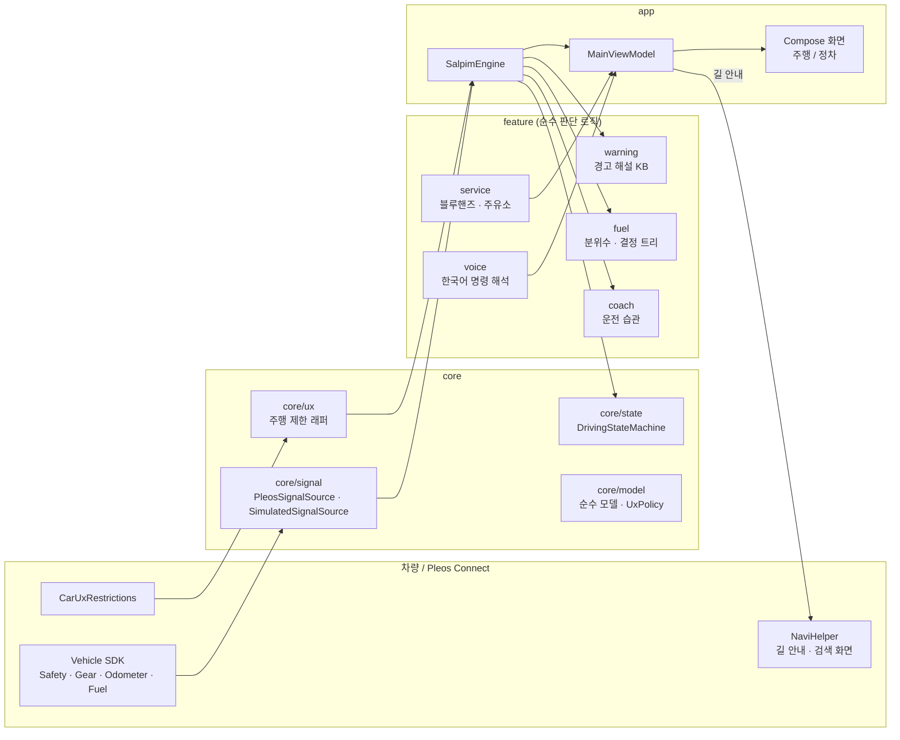
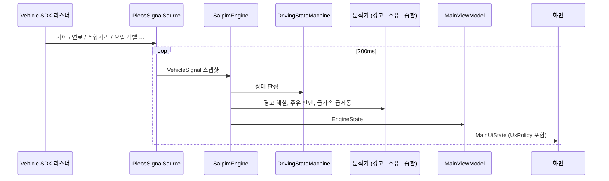
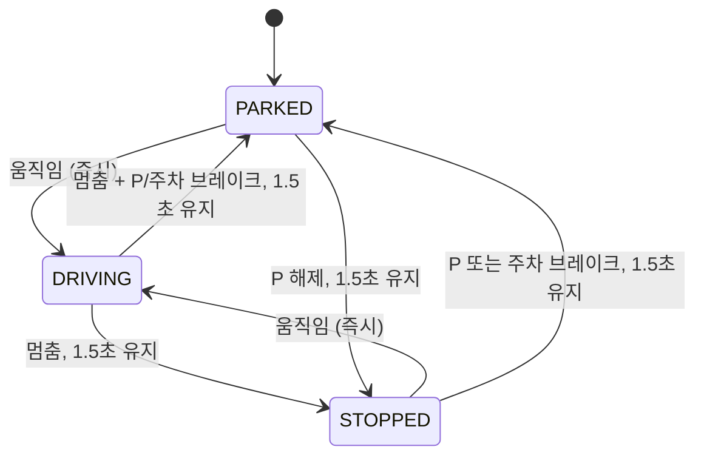
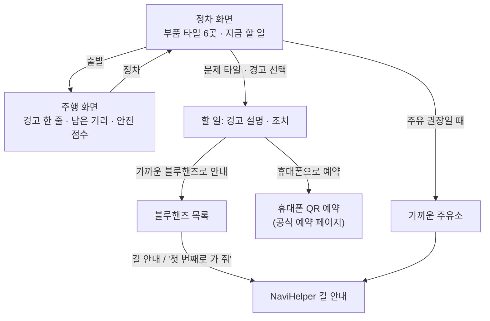
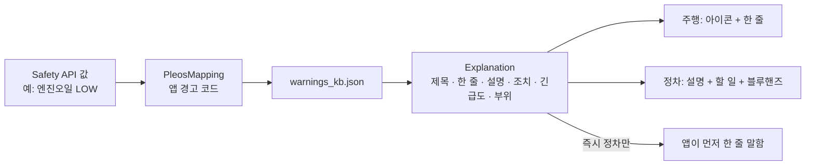
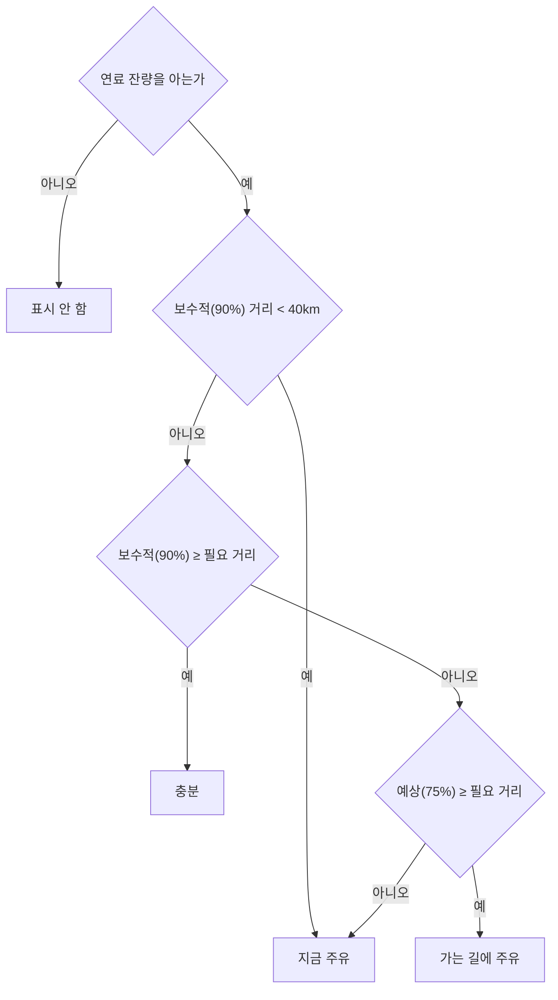
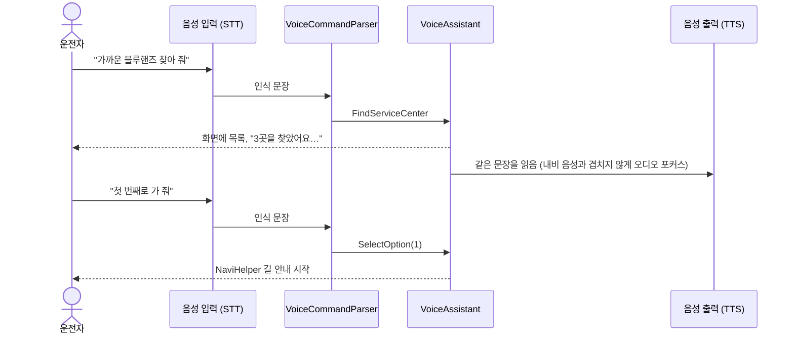
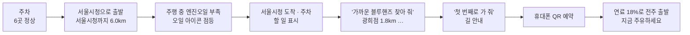

# 설계

살핌의 구조와 흐름을 그림으로 정리했다. 화면 디자인 규칙은 [DESIGN.md](DESIGN.md), 기획 배경은 [proposal.md](proposal.md), 실제 화면은 [screens/](screens/)에 있다. 그림은 Mermaid라 GitHub에서 바로 보인다.

## 1. 전체 구조

차량 신호 → 상태 판단 → 해설·예측 → 화면·음성. Pleos SDK는 `core/signal`에만, Android Car API는 `core/ux`에만 닿는다. 판단 로직은 모두 순수 Kotlin이라 기기 없이 단위 테스트한다.

| 모듈 | 하는 일 | 의존 |
|---|---|---|
| `core/model` | 신호·경고·상태 모델, `UxPolicy` | 없음 (순수 Kotlin) |
| `core/state` | 주차 / 정차 / 주행 판정 | model |
| `core/signal` | Pleos SDK 어댑터, 시뮬레이션 시나리오, NaviHelper 어댑터 | Pleos SDK |
| `core/ux` | `CarUxRestrictionsManager` 래퍼, 비자동차 기기는 정적 소스 | android.car |
| `core/designsystem` | 색·글자·간격 토큰, MDI 아이콘, 공용 컴포넌트 | Compose |
| `feature/*` | 경고 해설, 주유 예측, 습관, 장소, 음성 해석 | model |
| `app` | 파이프라인, ViewModel, 화면, 음성 대화 | 전부 |

## 2. 신호 파이프라인

리스너가 각자 값을 주므로 최신 값을 모아 200ms마다 스냅샷 하나로 내보낸다. 시뮬레이션도 같은 `VehicleSignal`을 내보내서 화면은 신호 출처를 모른다 (대신 시뮬레이션이면 "시뮬레이션 신호"를 항상 표시).

## 3. 주행 상태

움직이기 시작했는데 제한 없는 화면이 남아 있으면 안 되므로 **주행 진입은 즉시**, 나머지 전환은 1.5초 디바운스. 진입 5km/h, 이탈 1km/h로 경계에서 떨리지 않게 한다 (히스테리시스). 차속을 모르면(실차 Vehicle SDK에 차속 API 없음) 안전 쪽으로: 기어 D/R이고 주차 브레이크가 풀려 있으면 주행으로 본다. 시스템 주행 제한도 함께 반영한다.

움직임 = 속도 ≥ 5km/h (주행 중에는 > 1km/h면 계속 주행). 속도를 모르면 D/R + 주차 브레이크 해제.

| 상태 | 화면 | 규칙 |
|---|---|---|
| DRIVING | 주행 화면 | 정보 최대 3개, 입력·스크롤 없음, 음성만 |
| STOPPED · PARKED | 정차 화면 | 상세 설명, 블루핸즈 안내·예약, 리포트 |
| 시스템 주행 제한 활성 | 주행 화면 | 앱 상태와 상관없이 `UxPolicy`가 우선 |

## 4. 화면 흐름

주행 화면은 글보다 아이콘·색·막대로 읽힌다 (DESIGN.md 개정 3).

| 정보 | 주행 화면 표현 |
|---|---|
| 차 이상 | 부위 아이콘이 긴급도 색으로 한 번 켜짐 + 쉬운 말 한 줄 + 긴급도(색 + 모양) |
| 연료 | 주유 아이콘 + 남은 거리 막대(진한 = 90%, 옅은 = 75%, 눈금 = 필요 거리) + 숫자, 아래에 목적지까지 거리 |
| 운전 | 계기 아이콘 + 안전 점수 |

## 5. 경고 해설

경고 코드 → 지식 베이스(JSON, 앱 안) → 쉬운 설명·긴급도·조치. 네트워크 없이 동작하고, 모르는 코드는 "알 수 없는 경고, 점검 권장"으로 안내한다. "진단·고장" 같은 단정 표현은 쓰지 않는다.

| 긴급도 | 색 | 의미 |
|---|---|---|
| `IMMEDIATE_STOP` | 빨강, 네모 | 안전한 곳에 세우기 |
| `SERVICE_SOON` | 노랑, 원 | 점검 권장 |
| `INFO` | 파랑, 원 | 안내 |

## 6. 주유 예측

이 차가 연료 1%로 실제 몇 km를 갔는지 기록해 분포를 만든다. 남은 거리를 한 값이 아니라 "지난 주행의 90%를 덮는 거리(보수적)"와 "75%를 덮는 거리(예상)"로 보여 주고, 결정 트리로 판단한다. 기록이 부족하면 기본 연비로 계산한다.

필요 거리 = 목적지까지 남은 거리(없으면 0) + 여유 30km.

## 7. 음성

음성이 주 조작 방식이다. 마이크 버튼이나 예시 문장 칩 → 한국어 규칙 해석(오프라인) → 답은 소리와 화면 글자로 함께. 앱이 먼저 말을 거는 건 즉시 정차 경고 한 줄뿐이다.

알아듣는 말: 차 상태, 계속 달려도 되는지, 왜 그런지, 블루핸즈 찾기, 주유소 찾기, 남은 거리, 번호로 고르기, 다른 곳, 예약, 리포트, 기록 지우기, 네 / 아니요.

## 8. 시연 시나리오

시뮬레이션 신호로 같은 흐름을 재현한다 (`core/signal/sim/Scenarios.kt`). 주변 장소는 서울시청 기준 샘플 목록이다 (`feature/service/src/main/assets/nearby_places_sample.json`).

## 9. 데이터와 개인정보

- 운전 기록과 주유 기록은 차 안에만 저장하고, 앱에서 지울 수 있다
- 위치·운전 정보를 외부로 보내지 않는다. 외부 지도 API를 쓰지 않는다
- 블루핸즈 목록은 `NearbyPlaceRepository` 인터페이스 뒤에 있어, 제휴 시 현대 블루핸즈 데이터·예약 API로 교체한다
