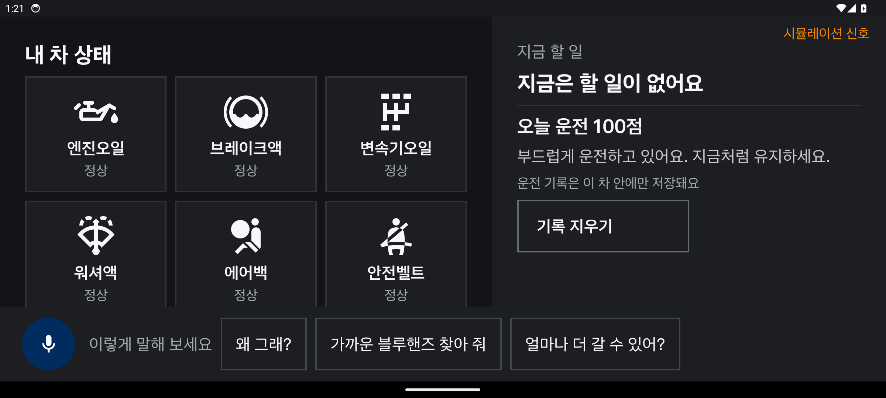
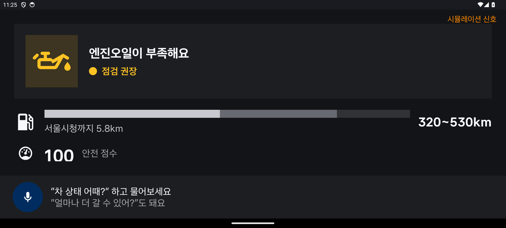
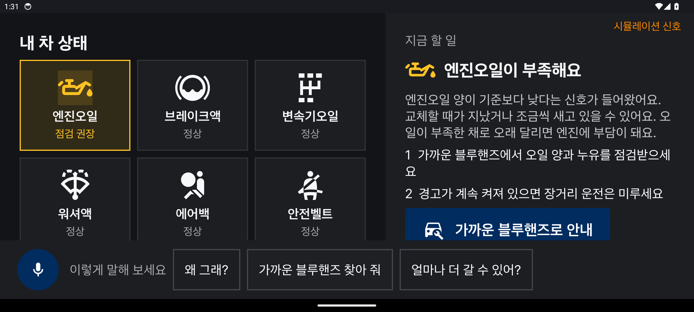
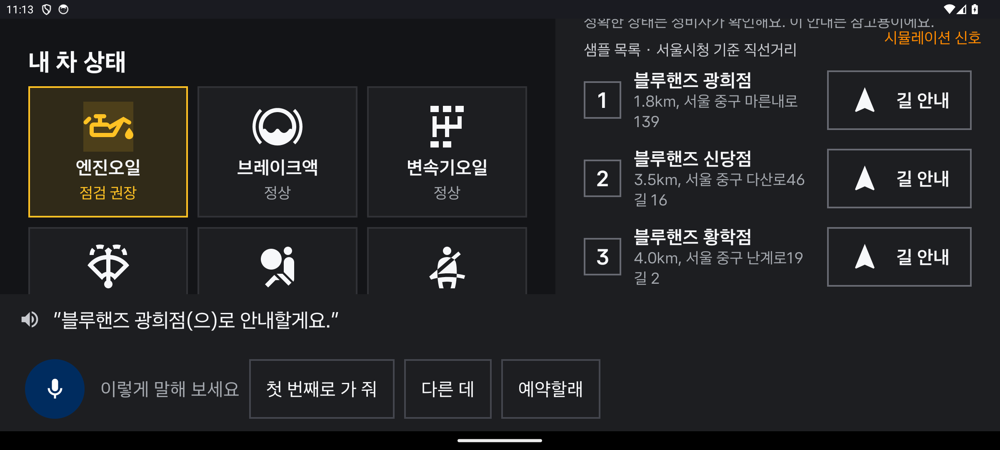

# 화면

일반 Android 에뮬레이터(API 34, 2400×1080)에서 시뮬레이션 신호로 실행한 실제 앱 화면입니다. 실제 차량에서는 내비 옆 앱 영역에 표시됩니다.

| | |
|---|---|
|  | **주차** — 부품 6곳을 아이콘 타일로. 자리는 고정, 문제 부위만 색으로 켜짐 |
|  | **주행 중** (서울시청으로 가는 길) — 경고 / 남은 거리와 목적지 / 안전 점수, 입력·스크롤 없음. 문제 부위 아이콘이 한 번 밝아지며 켜짐 |
|  | **정차 후** — 쉬운 설명과 할 일, 블루핸즈 안내 |
|  | **음성으로 블루핸즈 안내** — 서울시청 기준 샘플 목록(실제 주소, 직선거리), "첫 번째로 가 줘" |

아이콘: Material Design Icons (Apache-2.0).
