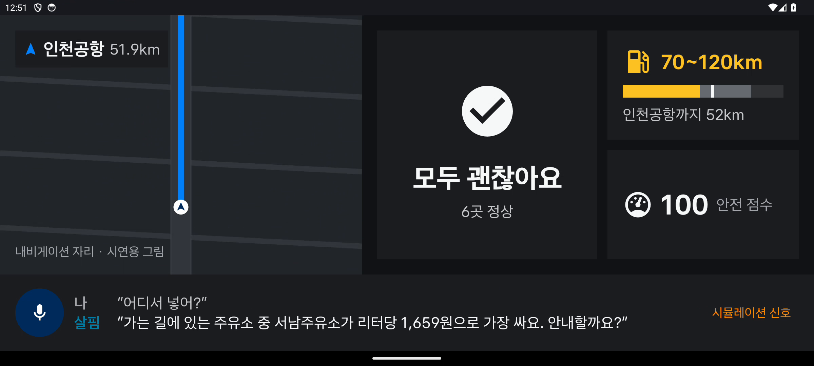
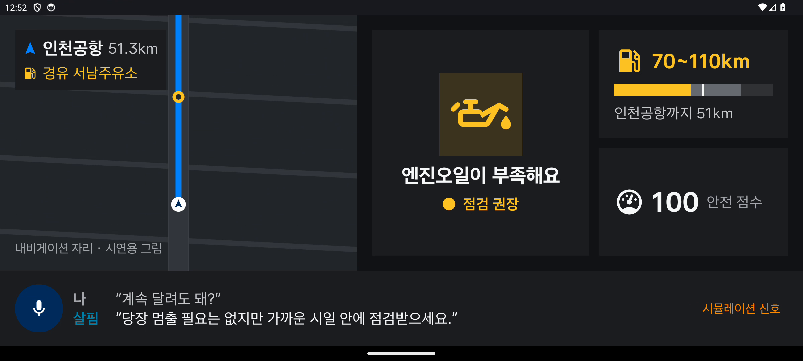
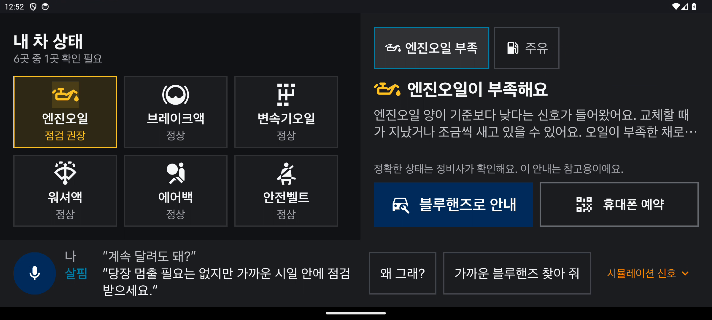
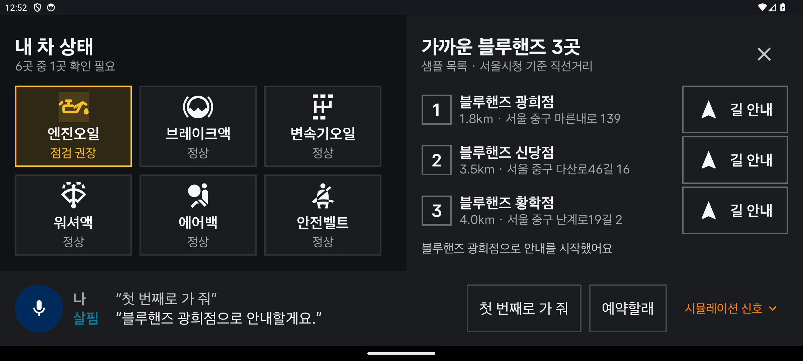
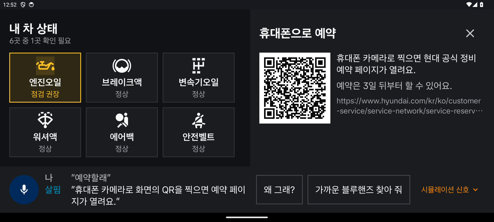

# 화면

일반 Android 에뮬레이터(API 34, 2400×1080)에서 시뮬레이션 신호로 실행한 실제 앱 화면입니다. 시연 영상(`release/salpim-demo-simulation.mp4`)의 대화 흐름 순서입니다.

주행 화면 왼쪽의 길 그림은 **시연용**입니다. 실제 차에서는 그 자리에 Pleos 내비가 뜨고 살핌은 옆에 붙습니다. 아래 음성 바에는 운전자가 한 말(나)과 살핌의 대답(살핌)이 함께 남습니다.

| | |
|---|---|
|  | **주차** — 부품 6곳 아이콘 타일, 할 일 없음. "인천공항 가 줘" |
|  | **주행 중, 연료가 모자람** — 살핌이 먼저 "가는 길에 주유해야 해요"라고 알리고, "어디서 넣어?"에 가장 싼 주유소를 권함 (가격은 샘플) |
|  | **주행 중 엔진오일 경고** — 아이콘이 노랗게 켜지고 한 줄. "계속 달려도 돼?"에 답함. 정보는 3개(상태·남은 거리·점수), 입력·스크롤 없음 |
|  | **정차 후 할 일** — 위 칩으로 할 일(엔진오일·주유)을 고르고, 맨 아래 버튼으로 바로 블루핸즈 안내·예약 |
|  | **블루핸즈 안내** — 서울시청 기준 샘플 목록(실제 주소, 직선거리). "첫 번째로 가 줘" |
|  | **휴대폰 예약** — 현대 공식 정비 예약 페이지 QR (ZXing) |

아이콘: Material Design Icons (Apache-2.0).
